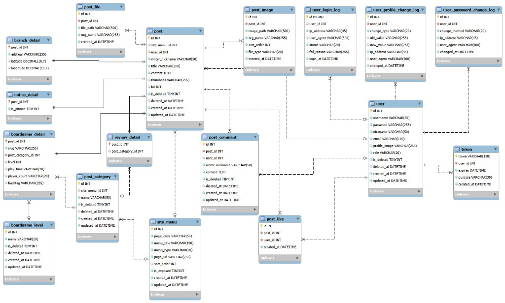

# 보드트립

보드게임 카페 소개와 이용후기를 위한 웹사이트입니다.

운영 주소: https://boardtrip.shop

## 주요 기능

- 회원가입, 로그인, 아이디 찾기, 비밀번호 재설정
- 마이페이지, 회원정보(프로필 이미지, 닉네임, 비밀번호) 수정, 회원 탈퇴
- 게임소개, 지점소개, 공지사항, 이용후기 게시판
- 댓글, 게시글 좋아요, 문의하기
- 일정 시간 입력이 없으면 자동 로그아웃 (60분)
- 소프트 삭제된 데이터와 오래된 로그를 지우는 예약 작업

게임소개, 지점소개, 공지사항은 관리자만 작성합니다. 이용후기는 로그인한 회원이 작성합니다.

게임소개에 등록된 게임, 지점소개와 이용후기의 지점은 포트폴리오용 가상 데이터입니다. 지점 주소만 카카오맵에 위치를 표시하려고 실제 지하철역으로 넣었습니다.

## 기술 스택

- PHP 8.4.20
- MariaDB (로컬 개발은 MySQL)
- Twig
- Bootstrap
- Composer
  - `twig/twig`
  - `ezyang/htmlpurifier`
  - `phpmailer/phpmailer`
  - `intervention/image`

## 로컬 실행

웹 서버의 문서 루트는 `public` 디렉터리여야 합니다. CSS와 주소가 `/`를 기준으로 연결되어 있습니다.

1. `.env.example`을 `.env`로 복사하고 데이터베이스, SMTP 값을 채웁니다. `DB_NAME`은 `boardgame_cafe`로 둡니다.
2. 빈 로컬 데이터베이스에 `docs/schema.sql`을 실행합니다. 이 스크립트는 `boardgame_cafe` 스키마를 만들고, 같은 이름의 테이블이 있으면 지운 뒤 다시 만듭니다. 데이터가 있는 데이터베이스에서는 실행하지 않습니다.
3. 의존성을 설치합니다.

```bash
composer install
```

4. 문서 루트를 `public`으로 둔 주소로 접속합니다.

테이블 정의는 `docs/schema.sql`에 있습니다. 관계는 아래 ERD와 같습니다.

`.env`에는 비밀번호를 넣습니다. 이 파일은 저장소에 올리지 않습니다.

## 디렉터리

| 경로 | 역할 |
| --- | --- |
| `public` | 웹에서 접근하는 진입점, CSS, 업로드 파일 |
| `src` | PHP 페이지, 컨트롤러, 데이터베이스 처리 |
| `templates` | Twig 화면 |
| `config` | 환경 설정 |
| `cron` | CLI로만 실행하는 정리 스크립트 |
| `docs` | ERD 이미지, 테이블 생성 SQL |

## 데이터베이스

게시글은 `post`에 모이고, 게시판별 추가 정보는 상세 테이블에 나뉩니다. 회원은 `user`에 두고, 로그인·정보 변경·비밀번호 변경 기록은 로그 테이블에 남깁니다.

| 테이블 | 역할 |
| --- | --- |
| `post` | 게시글 공통 정보 |
| `post_category` | 게시판별 분류. `site_menu`와 연결 |
| `boardgame_detail` | 게임소개. 주소용 슬러그, 난이도, 인원, 시간, 해시태그 |
| `boardgame_level` | 게임 난이도 |
| `branch_detail` | 지점 주소와 좌표 |
| `notice_detail` | 공지 상단 고정 여부 |
| `review_detail` | 이용후기가 속한 지점 분류 |
| `post_comment` | 댓글 |
| `post_like` | 게시글 좋아요 |
| `post_image` | 본문 이미지 |
| `post_file` | 첨부파일 |
| `user` | 회원 |
| `token` | 비밀번호 재설정 토큰 |
| `user_login_log` | 로그인 기록 |
| `user_profile_change_log` | 회원정보 변경 기록 |
| `user_password_change_log` | 비밀번호 변경 기록 |
| `site_menu` | 상단 메뉴 |



## 예약 작업

두 스크립트는 브라우저로 열 수 없고, 서버에서 PHP CLI로 실행합니다.

- `cron/cron_delete_soft_deleted.php`: 삭제한 지 30일이 지난 게시글, 댓글, 탈퇴 회원을 물리 삭제합니다.
- `cron/cron_delete_logs.php`: 6개월이 지난 로그인 로그, 1년이 지난 비밀번호 변경 로그와 회원정보 변경 로그를 삭제합니다.

서버 시각이 한국 표준시라면 예시는 아래와 같습니다.

```cron
0 4 * * * /usr/bin/php /var/www/html/cron/cron_delete_soft_deleted.php >> /var/log/cafe-cron.log 2>&1
10 4 * * * /usr/bin/php /var/www/html/cron/cron_delete_logs.php >> /var/log/cafe-cron.log 2>&1
```

경로는 서버에 올린 위치에 맞춥니다.
